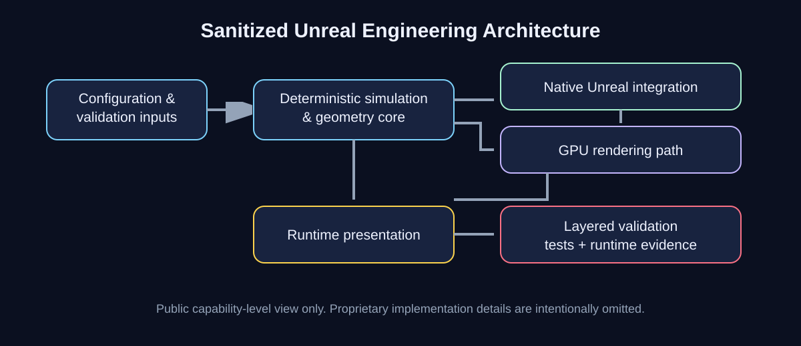

# Native Unreal Engine Mechanical Simulation & Section Rendering

**OSYSTIC ENGINEERING CASE STUDY - PUBLIC SHOWCASE - SANITIZED - PORTFOLIO-SAFE**

This is an independently authored, anonymized engineering case study. It contains no client source code, client identity, task identifiers, private repository links, screenshots, videos, session logs, proprietary assets, credentials, private conversations, or commercial information.

## What this repository is

A public capability record for a completed Unreal Engine engagement involving two demanding native-engine workstreams:

- deterministic mechanical simulation and presentation; and
- runtime section-plane visualization with GPU-assisted rendering and validation.

The confidential implementation remains in a client-controlled repository and is not copied or mirrored here.

## OSYSTIC PACE

### Problem & constraints

The work required production-quality Unreal Engine behavior under a strict code-driven workflow. The solution had to be deterministic, auditable, visually credible in motion, compatible with the required engine build, and validated with repeatable checks rather than screenshots alone.

Confidentiality was a first-class constraint: client implementation details and delivery evidence could not be reused as public portfolio material.

### Architecture & decisions

The private implementation separated responsibilities into native Unreal Engine C++ integration, deterministic geometry/kinematics logic, GPU shader/rendering work where the visual problem required it, externalized runtime parameters for repeatable validation, portable verification logic for non-editor regression checks, runtime GPU/CPU evidence checks for rendering correctness, and an evidence-driven delivery workflow.

The public diagram deliberately shows only these system boundaries and omits proprietary classes, algorithms, assets, parameters, topology, and client infrastructure.

### Contribution & delivery

OSYSTIC delivered two completed workstreams in the client's controlled repository. Engineering responsibilities included implementation, build/test automation, runtime validation, visual-quality iteration, evidence capture, and delivery documentation.

The work followed a code-only authoring model for committed behavior. No public source from the engagement is reproduced here.

### Evidence & outcomes

The confidential delivery record verifies that both completed workstreams were pushed to client-controlled task branches and submitted through separate pull requests. Validation included engine builds, automated regression checks, runtime verification, and visual evidence appropriate to each feature.

No client-specific acceptance thresholds or proprietary evidence are published in this repository. Public claims are intentionally limited to capabilities supported by the completed delivery record.

## Public vs private boundary

| Public showcase | Confidential delivery |
|---|---|
| Sanitized architecture | Full Unreal source |
| Engineering approach | Client task briefs and acceptance thresholds |
| Validation methodology | Detailed test outputs and session logs |
| Capability-level outcomes | Screenshots, video, assets and runtime captures |
| Lessons learned | Repository history, PR detail and client identity |

## Technology

Unreal Engine 5.8.3 | C++ | HLSL/GPU rendering | deterministic geometry | procedural simulation | runtime validation | regression testing | evidence-driven delivery

## What is intentionally not claimed

- publication rights to the confidential implementation;
- ownership of client source or assets;
- reproduction of the private codebase;
- disclosure of client identity or internal task details;
- exact proprietary acceptance thresholds;
- performance guarantees beyond the verified private delivery;
- that this public repository can rebuild the confidential project.

## Read more

- case-study.md - full PACE case study
- docs/technical-overview.md - sanitized technical architecture
- docs/validation-evidence.md - what was verified and what remains private
- docs/lessons-learned.md - reusable engineering lessons
- docs/disclosure-boundary.md - confidentiality boundary
- docs/publication-record.md - approval and sanitization record
- docs/runbook.md - public-showcase maintenance process

OSYSTIC - AI, automation, simulation and software engineering.
